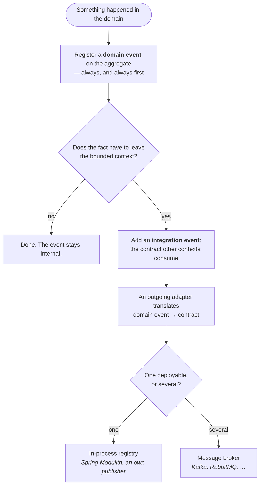

[Full node and context](/guide/rules/domain-layer-rules.md#integration-event-rules-cross-bounded-context). This is an evidence excerpt; retain the parent selection and caveats.

### Integration Event Rules (Cross-Bounded Context)
- Integration Events are DTOs representing domain events for external systems
- Integration Events defined in `{context}/events/` package
- Integration Events use past tense + "Event" suffix (e.g., OrderCreatedEvent)
- Integration Events must be serializable (JSON, Protobuf, Avro)
- Integration Events include: event ID, timestamp, correlation ID; the schema version and
  stable logical name are a **class property** via `@IntegrationEventType(name, version)` —
  never a `version` data field on the instance
- Integration Events created by Event Mappers in outgoing adapters
- Domain events never cross bounded context boundaries directly
- Event Mapper converts domain event → integration event DTO
- Integration Events must be backward compatible (add fields, don't remove)
- Integration Events contain only primitives and value types, no domain objects

**Integration Event Payload Styles** — choose per event type:

| Style | Payload | When |
|---|---|---|
| **Notification** | IDs only — consumer queries back via Open Host Service | Sensitive or large data; query-back doubles as authorization gate |
| **Event-Carried State Transfer** | Relevant state snapshot | Consumer maintains a local cache/replica, avoids chatty query-backs |
| **Domain Fact** | The business fact and its data | Consumer reacts to what happened, no replica needed |

Invariant in all styles: flat, serializable, versioned — never aggregate references.

**Decision Tree: Domain Event or Integration Event?**

**Domain event** — part of the domain model, so `{context}/domain/model/` or an own
`{context}/domain/event/` segment, whichever keeps the package readable. Named in the past
tense (`OrderCreated`), may carry domain objects, carries a timestamp (`DCA-ADV-008`) and no
schema version (`DCA-ADV-007`).

**Integration event** — the published contract. It lives in the context's `events/` segment
(`DCA-STR-007`), carries the `Event` suffix and `@IntegrationEventType(name, version)`
(`DCA-ADV-005`), holds only primitives and serializable types, and is immutable (`DCA-STR-008`).
The schema version belongs to that type metadata, never to the payload (`DCA-ADV-006`).

**The translator** is an outgoing adapter in `adapter/outgoing/event/`: it listens for the domain
event and publishes the contract. Transport and storage are separate adapters again.

**Delivery follows the deployment, not the boundary.** Inside one deployable, an in-process registry
carries the contract across a context boundary — that is what the reference implementation does, and
the boundary is no less real for it. Once the contexts are deployed separately, the same contract
goes over a broker: Kafka, RabbitMQ, whatever the operation runs. The contract does not change, the
adapter behind it does. Nothing above this line depends on the answer.
