Between the stages runs a **gate**: a deterministic check, callable from the command line and from
CI, that verifies what a stage may not decide for itself. It is not a review and it has no opinion;
it either finds the evidence or it does not.

| Before | The gate checks |
|---|---|
| plan | the epic is complete; the story is well-formed, released, marks exactly one happy path, and its context is on the map |
| after test | every criterion is mapped to a test; the test exists in the sources; the test sources compile; **every mapped test is red**; an end-user test belongs to the happy path or a `browser-only` scenario |
| after build | every mapped test is green **and was recorded red by the test stage**; the architecture suite passes; the formatter passes; every file the plan names `new` is there and every one it names `removed` is gone |
| after tidy | the same checks again — the stage's whole claim is that nothing changed |
| after document | every path and identifier the stage claims exists; every glossary row says how it was checked |

Three details in there are worth more than they look.

**A missing test looks exactly like a red one at the runner.** So the gate first finds the test in
the sources; without that, "red before the build" certifies nothing.

**A run that matched no test at all exits successfully on some runners and unsuccessfully on
others.** Neither outcome is evidence. So a mapped test is run with the command that covers the
source set the test actually lives in, and a test in a source set no command covers is a
configuration error rather than a verdict.

**Neither an exit code nor a message says that a test ran.** An exit code says how a process
ended; a runner that never found the test can exit exactly like one whose test failed, and a
crashed test host does too. Output is no better: a runner that prints "no tests found for
<selector>" says something different for every selector while executing nothing. The only artefact
that states what was *executed* is the runner's report — and every ecosystem can write one in a
format two parsers cover, so requiring it costs a project a flag, not a rewrite. Where a stack
genuinely has none, weaken the check explicitly and print that weakening next to every verdict it
produces; a silent weakening is the same as none.

**A report is evidence only if it is *this* run's and *this* test's.** Two ways to be wrong about
a report, and both look like a pass. A file left by an earlier run still lies where the reader
looks, so a runner that finds nothing now inherits yesterday's verdict — which means a report
counts only where its content changed or its timestamp is younger than the invocation, read against
the filesystem's own clock rather than the process's. And a report that names a *sibling* of the
mapped test says nothing about it: where a runner reports display names instead of method names,
the mapping has to come from the declaration in the code, never from membership of the same class.
Not even a single reported case settles it — a filtered run is no promise that the filter was
honoured, so that one case may be the sibling, and attributing it would let one test's outcome
decide another's criterion. Either a name matches, or there is no evidence.

**A test that was never red proves nothing.** The test stage records which selectors it saw fail;
the build gate accepts a green test only if it is in that record. This is what closes the gap
between "the criterion is met" and "something green exists".

A command the project has not declared is **skipped and named**, never failed. A gate that fails on
something nobody configured gets switched off, and then there is no governance at all. The one
exception is one the project writes itself: a `required:` line in the same file names the checks
that must hold, and a required check that is missing or ran nothing fails.

The same commands belong on the **commit** as well. Tool configurations do not travel between
editors, but every tool commits through version control, so a pre-commit check that runs the
project's own compile, test, architecture and format commands is the boundary that holds for
everyone. Keep it to what a developer will wait for; a check that takes minutes gets bypassed, and
then it guards nothing.

### Where a refusal sends the story

```mermaid
flowchart LR
  gate_before_plan(("✓")):::gate
  plan["plan"]:::step
  test["test"]:::step
  gate_after_test(("✓")):::gate
  build["build"]:::step
  gate_after_build(("✓")):::gate
  tidy["tidy"]:::step
  gate_after_tidy(("✓")):::gate
  judge["judge"]:::step
  document["document"]:::step
  gate_after_document(("✓")):::gate
  integrate["integrate"]:::step
  gate_after_integrate(("✓")):::gate
  delivered(("delivered")):::done
  gate_before_plan --> plan
  plan --> test
  test --> gate_after_test
  gate_after_test --> build
  build --> gate_after_build
  gate_after_build --> tidy
  tidy --> gate_after_tidy
  gate_after_tidy --> judge
  judge -- "RUN-VERDICT-1" --> document
  document --> gate_after_document
  gate_after_document --> integrate
  integrate --> gate_after_integrate
  gate_after_integrate --> delivered
  plan -. "again" .-> plan
  gate_after_test -. "again · 20 checks" .-> test
  build -. "GATE-RED-PROOF · RUN-ROUTE-5 · RUN-BACK-1" .-> test
  gate_after_build -. "again · 14 checks" .-> build
  tidy -. "GATE-RED-PROOF · RUN-ROUTE-5" .-> test
  gate_after_tidy -. "again · 14 checks" .-> tidy
  judge -. "again" .-> judge
  judge -. "RUN-VERDICT-1" .-> build
  judge -. "RUN-VERDICT-1" .-> test
  gate_after_document -. "again · 10 checks" .-> document
  document -. "GATE-ACCEPTANCE" .-> plan
  gate_after_integrate -. "again · 14 checks" .-> integrate
  integrate -. "RUN-INTEGRATE-1" .-> build
  classDef step fill:none,stroke:none,font-weight:bold
  classDef gate fill:#148f96,stroke:#148f96,color:#ffffff
  classDef done fill:none,stroke:#1c2433
```

<!-- generated from the factory's rulebook, the flow of a story as its rules say it; regenerate it, never edit it -->

A refused gate sends the story back into the stage it follows — a round. Three rounds without convergence stop the
story, and a person looks. Some outcomes send it further back: a test changed since it was recorded red goes back to
the test stage, the judge's requested changes go to build or to test, a correction from the acceptance starts over at
plan, a refusal on the main line goes back to build. Each label is the id of the rule that decides the way; the
factory's rulebook says when it applies, how it comes out and why.
