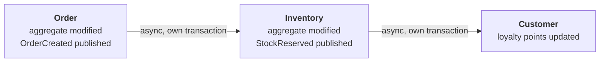

### Transaction Boundary Placement
- **Transaction boundaries live at the use case level** (application layer)
- One transaction = one aggregate modification (single aggregate rule)
- **Every use case that saves or deletes an aggregate draws the boundary, events or not** — a repository may write one aggregate (root, entities, value objects) as several statements across several tables and draws no boundary of its own; the use case owns the unit of work (`DCA-USE-012`)
- Use `@Transactional` (or equivalent) on use case implementations **whose work is entirely local** — repositories, stores, event publishers
- **Never call a remote-capable port inside the transaction.** A port that may leave the process (another context's API, a payment provider, a mail gateway) called inside `@Transactional` holds the database connection for the remote round trip; under load the pool runs dry, and a rollback cannot undo the remote effect
- Use cases that need such a port **draw the boundary by hand** with `TransactionBoundary` (an application-layer execution abstraction — not a port; implemented in infrastructure): remote reads first, then `transactionBoundary.inTransaction(load, mutate, save, publish)`; remote effects after the commit, as a reaction to an integration event
- **A remote effect inside the use case comes after the aggregate has agreed to it.** When the effect cannot wait for the commit — a payment intent, a reservation, a label — load the aggregate first and ask it: give it a method that asserts the preconditions of the mutating one and changes nothing (`assertReadyFor…()`). Otherwise the effect exists at the other system for an operation this system then refuses, and a rollback does not reach it
- **Say what closes the remaining window.** The check cannot be atomic with the write, so either compensate on failure (call the port's release operation for the reference just made, re-throw the original failure or return its case, log a refused compensation rather than raising it) or make the effect idempotent under a key derived from the aggregate's identity. Compensation uses the port as it stands; idempotency changes its contract. Whichever is chosen, record that a process dying in between orphans the effect and only reconciliation finds it
- **Decide, then write.** A use case writes only once it can no longer refuse: every refusal — thrown or returned —
  comes before the first `save`. A refusal that can only come after a write is a wrong cut, two aggregates changed
  in one transaction
- **A returned refusal rolls back like a thrown exception.** Every refusal case of a result implements `Refusal`;
  `TransactionBoundary.inTransaction` and the interceptor around a `@Transactional` use case roll back when the work
  returns one. The net catches a violation of the rule above; it is not a reason to write first (see
  [A refusal and the transaction](#a-refusal-and-the-transaction))
- **A step after the commit only reads** — a rollback no longer reaches it
- Domain layer is transaction-agnostic

### Cross-Aggregate Consistency
- **Within same bounded context**: eventual consistency via domain events
- **Across bounded contexts**: eventual consistency via integration events
- Never modify multiple aggregates in one transaction

### Transaction Pattern Example
```java
@Service
public class CreateOrderUseCase implements CreateOrderInputPort {

    private final OrderRepository orderRepository;
    private final DomainEventPublisher eventPublisher;

    @Transactional  // Transaction boundary at use case level
    @Override
    public CreateOrderResult execute(CreateOrderCommand command) {
        // 1. Domain logic (within transaction)
        Order order = Order.create(command.customerId(), command.items());

        // 2. Persist single aggregate
        orderRepository.save(order);

        // 3. Publish events (after persistence, before commit)
        eventPublisher.publishAndClearEvents(order);

        return CreateOrderResult.from(order);
    }
}
```

### Eventual Consistency Example


One aggregate per transaction. Each consumer commits its own, and the chain is consistent only
once the last one has.

### Remote Port Example — Boundary Drawn by Hand
```java
@Service                                   // no class-level @Transactional
public class AddItemToCartUseCase implements AddItemToCartInputPort {

    private final ShoppingCartRepository carts;
    private final ArticleDataPort articles;          // reaches another context — remote-capable
    private final DomainEventPublisher eventPublisher;
    private final TransactionBoundary transactionBoundary;             // application-layer abstraction (not a port) → TransactionTemplate

    @Override
    public AddItemToCartResult execute(AddItemToCartCommand command) {
        // 1. Remote-capable read — outside the transaction
        Optional<CartArticle> article = articles.getArticleData(command.productId());
        if (article.isEmpty()) {
            return new ProductNotAvailable(command.productId());       // refused before the transaction opens
        }

        // 2. Short transaction: load, decide, then write
        return transactionBoundary.inTransaction(() -> {
            Optional<ShoppingCart> found = carts.findById(command.cartId());
            if (found.isEmpty()) {
                return new CartNotFound(command.cartId());              // refused before anything is written
            }
            ShoppingCart cart = found.get();
            try {
                cart.addItem(command.productId(), command.quantity(), Price.of(article.get().currentPrice()));
            } catch (CartAlreadyCompletedException completed) {
                return new CartAlreadyCompleted(completed.cartId());    // the model's refusal, still before the save
            }
            carts.save(cart);
            eventPublisher.publishAndClearEvents(cart);
            return new ItemAdded(cart.id());
        });
    }
}
```

This is the returned form. In a context that throws, the same steps raise `ProductNotAvailableException` and
`CartNotFoundException` — use-case exceptions — and let `CartAlreadyCompletedException` pass; every `throw` sits at
the same place, before `carts.save`. Either way the boundary rolls back a refusal, and either way nothing is
written before the last point that can refuse.

Two rules of the DCA catalog make this a compile-time fact: `DCA-USE-012` — a use case that saves or deletes an aggregate through a `Repository`, or publishes domain events, has a transaction boundary — declarative `@Transactional` **or** an explicit `TransactionBoundary.inTransaction` (the repository may write one aggregate as several statements; the use case owns the unit of work even when no event is published); `DCA-USE-013` — a `@Transactional` use case calls no output port other than `Repository`, `Store`, `DomainEventPublisher`, `IntegrationEventPublisher` (`TransactionBoundary` is not a port; a use case that needs remote reads draws the explicit boundary instead of the annotation). In .NET the boundary is a decorator around `IUseCase<,>` or `ITransactionBoundary.InTransactionAsync`; `DCA-NET-006` keeps EF Core, `System.Data` and `System.Transactions` out of the application layer.

A workflow across several aggregates or contexts that outlives one transaction is a process manager — a use case with a tracker — or, where steps are compensated, a saga (see [A process that spans several transactions](/guide/integration-patterns/a-process-that-spans-several-transactions.md)).

## Related mentions (heuristic)

- [TransactionBoundary](/marker/application/transactionboundary.md)
- [DomainEventPublisher](/marker/port-out/domaineventpublisher.md)
- [IntegrationEventPublisher](/marker/port-out/integrationeventpublisher.md)
- [Repository<T, ID>](/marker/port-out/repository.md)
