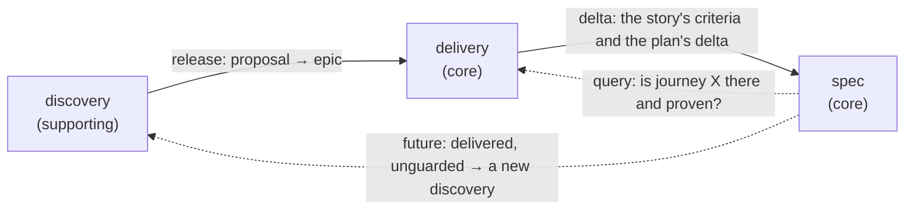

# Context map — the factory

The factory's package (`skills/factory-run/scripts/dca_factory/`) is built the way it teaches: three bounded contexts,
each in DCA layers, a shared kernel, the building blocks outside them, a web host across them and a composition root.

| Context | Subdomain | Language | Glossary |
|---|---|---|---|
| **discovery** | supporting | problem, option, outcome, evidence, proposal, report | [glossary/discovery.md](glossary/discovery.md) |
| **delivery** | core | epic, story, decision record, stage, gate, journal, usage — features: backlog, decisions, delivery, description, cost | [glossary/delivery.md](glossary/delivery.md) |
| **spec** | core | criterion, rule, scenario, feature, test line, journey, delta | [glossary/spec.md](glossary/spec.md) |

## Relationships

**discovery → delivery — Customer/Supplier, at the release of a proposal.** Discovery writes a report and proposes
epics (and description changes); it never edits the backlog or the description itself. A person releases a proposal;
it is translated one to one into an epic — intent, goal, metric, domain contact — that links its report, and from
then on the epic is delivery's. Which proposals became epics, discovery asks delivery, not its files.

**delivery → spec — Customer/Supplier, at the delta.** Delivery hands over a story's criteria and the plan's delta
(added, changed, removed, moved, renamed); spec merges them into what holds. Spec publishes it as an open host service,
`spec/api/`: a criterion as an entry, the delta as the plan writes it, problems as sentences. Spec knows no story, no epic and no way
of delivery: two implementations of the same backlog end in the same spec. Delivery asks spec in spec's terms
whether a journey is there and proven; "delivered, unguarded" is delivery's state.

**spec → discovery — not built.** An epic delivered and unguarded, or an outcome that does not happen, would start a
new discovery: a future crossing, shown so it is not forgotten.

## Outside the contexts

| Part | What it is |
|---|---|
| `building_blocks.py` | the markers of `dca-building-blocks`, in Python — a dependency of every context, depending on none |
| `sharedkernel/` | what several contexts read alike: a project's markdown (front matter, sections, the text) |
| `web/` | the host that shows every context at once — the page and its server; it calls read models and use cases only |
| `infrastructure/` | the composition root: wires each port to its adapter |

`contract.py` at the package's top is the version stamp alone — `CONTRACT` and `VERSION`, read by
name by `factory.sh` and by an installed copy of any other release. The modules not yet moved into a
context (`state`, `gate`, `runner`, `cli`) sit beside it until their move; `factory-verify` holds the
layers of everything moved (`architecture.py`) and `mypy --strict` its types (`mypy.ini`).
